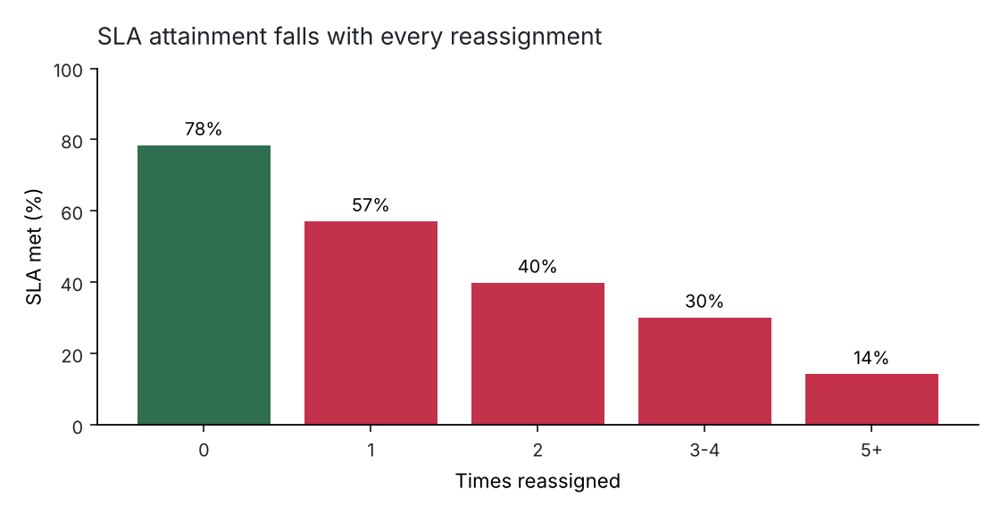
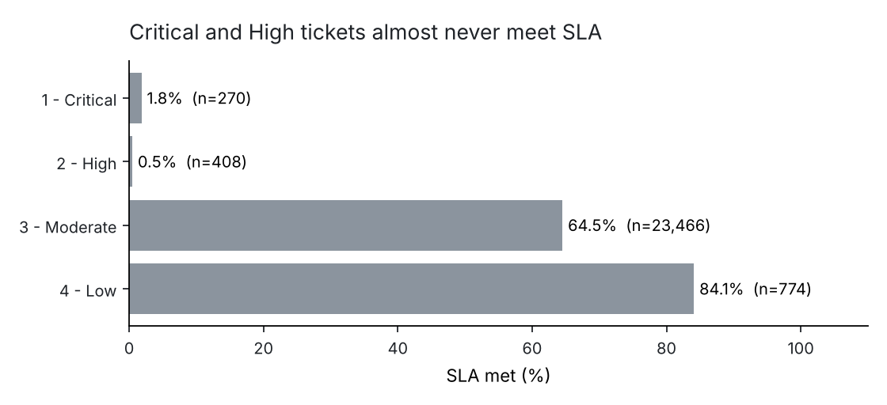
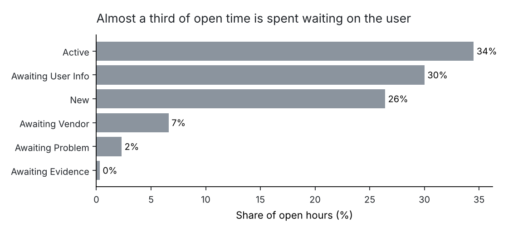

# ServiceNow Service Desk Analytics: Why a third of tickets miss SLA

**Data:** a real ServiceNow incident audit log. 141,712 audit events covering 24,918 incidents, Feb 2016 – Feb 2017.
**Tools:** Python (pandas) · SQL (SQLite) · Power BI semantic model and DAX · pytest · matplotlib.
**Question:** The desk meets SLA on 63% of tickets. Where are the other 37% being lost, and what can be changed in ServiceNow to fix it?

---

## Summary

| | |
|---|---|
| SLA attainment | **63.4%** (9,115 breaches) |
| Tickets reassigned at least once | **45.6%** |
| SLA when never reassigned | **78.4%** |
| SLA when reassigned 5+ times | **14.3%** |
| Breaches that involved a reassignment | **67.9%** |
| Share of open time spent *Awaiting User Info* | **30%** |
| Critical / High tickets meeting SLA | **1.9% / 0.5%** |

**Three findings, three changes:**

1. **Reassignment is the biggest driver of missed SLA.** Each handoff costs about 15–20 points of attainment, and the pattern holds within the same priority. Two-thirds of all breaches came from reassigned tickets. → **Add assignment rules for the subcategories that are routed wrong most often.** Eleven rules, fit on the first 60% of the year and tested on the rest, raised first-touch accuracy on the tickets they covered from 51% to 82% (138 fixed, 3 broken).
2. **Critical and High tickets almost never meet SLA, even when nobody reassigns them** (3.6% for Critical with zero handoffs). That's not a performance problem; the SLA definitions for P1/P2 don't match how this desk actually works. → **Audit the P1/P2 SLA definitions and the priority matrix** before using SLA as a team KPI.
3. **30% of open hours are spent waiting on the person who raised the ticket.** 5,464 incidents went into *Awaiting User Info*, with a median wait of 96 hours. → **Collect the right information at intake** (required fields per category in the service portal) so the ticket doesn't stall on the first follow-up question. This is the starting point for [Project 4](../04-contractor-onboarding-product-case/).

---

## 1. Sourcing the data

The data is the UCI *Incident management process enriched event log* (Amaral et al., CC BY 4.0), exported from the ServiceNow instance of an IT company. Each row is one entry in the incident's audit history (`sys_audit`), so one ticket appears once per update. It holds 36 fields, including state, assignment group, priority, `reassignment_count`, `made_sla` and timestamps.

I used it because it has the same mess I dealt with in ServiceNow at work: audit history instead of one clean row per ticket, fields that change over a ticket's life, and lots of blanks.

## 2. Cleaning: what I found and what I did about it

| Issue | Rows | Decision | Why |
|---|---|---|---|
| Unknown values exported as `?` | throughout | Read as null | `?` is ServiceNow's export placeholder, not a value |
| `incident_state = -100` | 5 | Dropped | Not a valid state |
| `caused_by`, `vendor`, `cmdb_ci`, `rfc`, `problem_id` | >98% blank | Dropped | Too sparse to analyse; a sign CMDB and problem linking weren't used |
| `made_sla` flips during a ticket's life | 9,114 incidents | Use the **final** audit record | The flag turns false when the SLA clock expires, so earlier rows overstate attainment |
| No `resolved_at` | 1,556 incidents | Kept for SLA, excluded from time-to-resolve | Dropping them would bias SLA upward |
| Zero or negative gaps between audit entries | 14,117 / 5 | Zero kept, negative dropped | Zero is a bulk update; negatives are clock or ordering errors |

Audit entries are ordered by `sys_mod_count`, then `sys_updated_at`, which is the order ServiceNow wrote them. Every rule is logged to [`reports/data_quality_log.csv`](reports/data_quality_log.csv).

## 3. Modelling

```
raw audit log ──► ingest.py (clean) ──► model.py ──► SQLite warehouse ──► marts.sql ──► figures, summary.json, web dashboard
                                         │
                                         ├─ fct_incident        1 row per ticket (final state + derived fields)
                                         ├─ fct_state_interval  time between audit entries, by state
                                         └─ fct_group_handoff   each change of assignment group
```

The reporting views in [`sql/marts.sql`](sql/marts.sql) produce every number in this README. [`powerbi/`](powerbi/) documents the same model as a Power BI star schema, with the DAX measures and report pages.

## 4. Analysis

### Reassignment drives missed SLA



Median time to resolve is **0.7 hours** for tickets that stay with one group and **80 hours** for tickets that move. A fair objection is that complex tickets get reassigned *because* they're complex. So I held priority constant: within Moderate priority (94% of tickets), SLA still falls from 79.6% at zero handoffs to 13.9% at five or more. Priority doesn't explain it away. It's still a correlation, not a controlled experiment, so I'd call it the strongest lever to test, not a proven cause.

**Where tickets bounce.** Group 70 is the front line: it receives 52% of all first assignments and resolves 72% of them itself. The busiest route is Group 70 ↔ Group 20, in both directions, more than 1,000 times each. Of the 1,088 handoffs from Group 20 back to Group 70, **430 were bounce-backs**: tickets returning to a group that had already passed them on. Group 20 resolves only 12% of the tickets it receives first.

### Can routing be fixed with simple rules?

I wanted a recommendation I could defend, so I tested it before suggesting it ([`src/routing.py`](src/routing.py)):

1. Split tickets by open date: the first 60% for building rules, the last 40% for testing.
2. For each subcategory, find the group that most often resolved it in the build period.
3. Keep a rule only where it beats current routing by at least 15 points, with at least 30 tickets.
4. Measure on the test period only.

| Test period | |
|---|---|
| Tickets covered by the 11 rules | 449 of 9,102 |
| First-touch accuracy, current routing | 51.5% |
| First-touch accuracy, with rules | **81.5%** |
| Tickets fixed / broken | **138 / 3** |

What I *didn't* recommend: routing every ticket by subcategory. On tickets that are routed correctly today, that approach would agree only 73% of the time, so it would break more than it fixes. The rules belong only where the evidence is strong. The full list is in [`reports/routing_rules.csv`](reports/routing_rules.csv).

### Priority and SLA definitions



Critical and High tickets meet SLA 1.9% and 0.5% of the time. Their median resolution times (80h and 38h) are longer than Moderate's, so they aren't being worked faster. And with *zero* reassignments, Critical still meets SLA only 3.6% of the time. When a target is missed 98% of the time, the target or the priority mapping is wrong. Tickets where the priority was confirmed (`u_priority_confirmation`) meet SLA 67% of the time vs. 51% unconfirmed, which supports checking priority at triage.

### Where the time goes



*Awaiting User Info* holds 30% of all open hours. Whether that counts against SLA depends on whether the SLA definition pauses in that state, and the export doesn't say. Either way, the person waiting for help experiences the full wait.

## 5. Recommendations

| # | Change in ServiceNow | Owner | How to measure it |
|---|---|---|---|
| 1 | Add the 11 tested assignment rules (`sys_assignment_rule` / Assignment Lookup Rules) for the listed subcategories | Service desk lead + platform admin | First-touch resolution % and SLA for those subcategories, 8 weeks before vs. after |
| 2 | Review the P1/P2 SLA definitions and the impact × urgency priority matrix; require priority confirmation at triage | ITSM process owner | P1/P2 attainment; share of tickets with priority confirmed |
| 3 | Add required fields per category to the portal record producer so tickets aren't raised incomplete | Service portal product owner | Share of tickets entering *Awaiting User Info*; hours spent there |
| 4 | Put a bounce-back report in front of Groups 20 and 70 every week | Group managers | Bounce-back incidents per week |

## 6. Limitations

- Time-in-state uses calendar hours, not business hours, because the log has no schedule data.
- The SLA definitions themselves aren't in the export, so finding 2 is a strong signal to investigate, not proof of a misconfiguration.
- Group, category and user names are anonymised, so I can't name the teams or services involved.
- Reassignment vs. SLA is observational. The routing rules are tested on a later time period, which is the fairest check possible without a live A/B test.

## Reproduce

```bash
pip install -r ../requirements.txt
python src/run_pipeline.py      # ~10 seconds: builds data/service_desk.db, reports/, figures
pytest -q tests                 # 9 data-quality and logic checks
```

The raw file (`data/raw/incident_event_log.zip`, 2.4 MB) is included under its CC BY 4.0 licence.

**Data credit:** Amaral, C., Fantinato, M., & Peres, S. *Incident management process enriched event log* [Dataset]. UCI Machine Learning Repository, CC BY 4.0. https://archive.ics.uci.edu/dataset/498/incident+management+process+enriched+event+log
