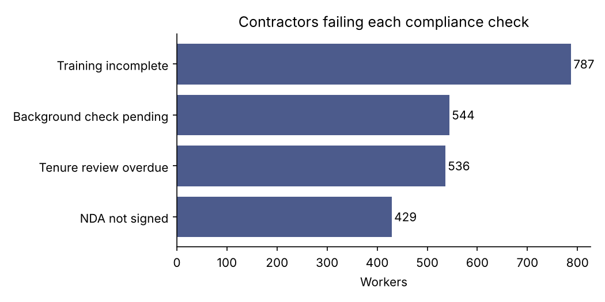
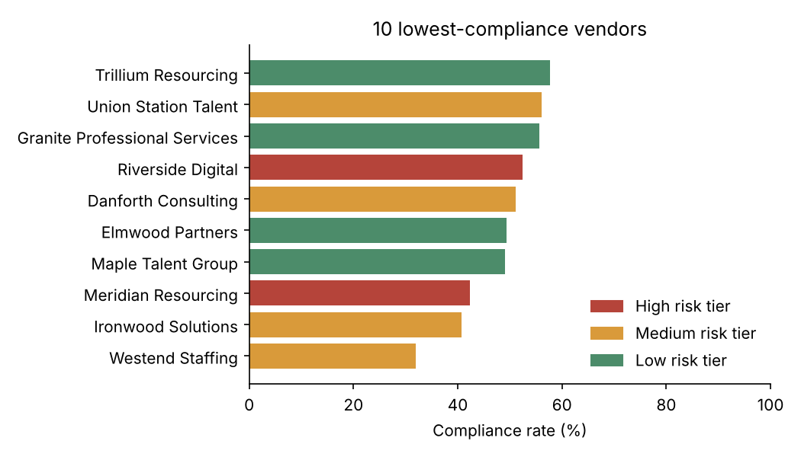

# Contingent Workforce Compliance Analytics

**Problem:** A large bank uses thousands of contractors supplied by dozens of staffing vendors. Each contractor must pass four checks: background check, signed NDA, completed training, and a tenure review after 24 months. The data arrives as messy vendor exports, and leadership needs to know who is non-compliant, which vendors are the problem, and where to act first.

**What I built:** a Python cleaning pipeline, a SQL reporting model with five compliance queries, and a Power BI measure set for a one-page leadership dashboard.

> All data is synthetic, generated by `generate_data.py`. It is modelled on the kind of program I supported at Scotiabank, but contains no real people, vendors or numbers.

## Tools
Python (pandas) · SQL (SQLite: joins, `HAVING`, `UNION ALL`, window functions) · Power BI / DAX · matplotlib

## How to run
```bash
python generate_data.py   # creates data/vendors.csv and data/contingent_workers_raw.csv
python pipeline.py        # cleans, loads, queries, writes outputs/
```

## 1. Data cleaning

| Problem in raw export | Fix | Rows affected |
|---|---|---|
| Exact duplicate rows | Dropped | 120 |
| Business unit casing and stray spaces (`"TECHNOLOGY"`, `" Risk "`) | Trimmed and title-cased | 150 |
| Mixed flag values (`Y`, `yes`, `N`, `no`) | Mapped to 1 / 0 | 50 |
| Start date recorded as `"not provided"` | Dropped (can't assess tenure) | 20 |
| Missing bill rate | Filled with the median for that role | 40 |

5,120 raw rows → **4,980 clean rows**. The full log is saved to `outputs/data_quality_log.csv`.

## 2. Findings

- **Overall compliance is 62.1%** (3,094 of 4,980 contractors pass all four checks).
- **Training is the biggest gap:** 787 contractors haven't completed it, ahead of pending background checks (544), overdue tenure reviews (536) and unsigned NDAs (429).
- **Vendor risk tiers don't match reality.** Four of the 10 worst vendors are rated *Low* risk, including Maple Talent Group (49% compliance) and Granite Professional Services (56%), the two largest vendors on the list. The tiering should be reviewed against actual performance.
- **Westend Staffing is the most urgent case:** the lowest compliance rate (31.9%) and a contract ending 2026-02-06 with 175 non-compliant contractors. That renewal is the moment to require remediation.
- **Business units are close (59.7%–65.4%)**, so the problem is vendor-driven rather than unit-driven.




## 3. Recommendations
1. Make training completion a condition of contractor start dates, since it is the largest single gap.
2. Re-tier vendors quarterly using compliance rate, not only the initial risk assessment.
3. Tie the four expiring contracts' renewals to a remediation plan, starting with Westend Staffing.

## 4. Power BI
`powerbi/dax_measures.md` has the data model, the DAX measures (compliance rate, `RANKX` vendor ranking, target flag, month-over-month change with `DATEADD`) and a one-page layout.

## Files
```
generate_data.py          synthetic data with realistic mess
pipeline.py               clean → validate → derive → load → report
sql/schema.sql            reporting tables
sql/compliance_queries.sql  5 named queries the pipeline runs
powerbi/dax_measures.md   Power BI model, measures and layout
outputs/                  clean data, query results, charts
```
