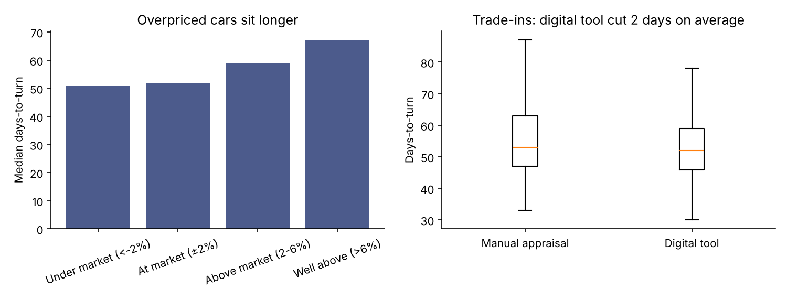
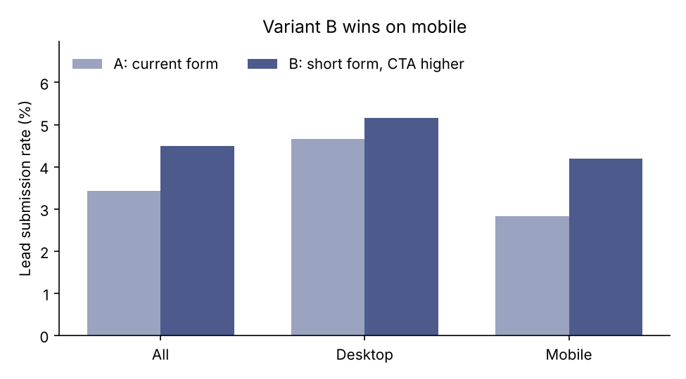

# Dealership Inventory Turnover & A/B Test Analysis

**Problem:** A used-car dealership loses money on every day a car sits unsold (financing, depreciation, lot space). Two questions from the owner:
1. What makes cars sit on the lot, and did the new **digital appraisal tool** for trade-ins actually help?
2. The website team tested a **shorter lead form with the call-to-action moved higher** (variant B). Did it really increase leads, or is it noise?

> All data is synthetic, generated by `generate_data.py`. It is modelled on the kind of work I did at Jones Autos, but contains no real vehicles, customers or results.

## Tools
Python (pandas, NumPy) · SciPy (Mann-Whitney U test, two-proportion z-test, confidence intervals) · matplotlib

## How to run
```bash
python generate_data.py
python analysis.py
```

## Part 1: Inventory turnover (1,400 vehicles)

**Pricing is the biggest driver.** Cars listed well above market (>6%) took a median **67 days** to sell, versus **51–52 days** for cars at or under market.

| Pricing vs. market | Vehicles | Median days-to-turn |
|---|---|---|
| Under market (< -2%) | 271 | 51 |
| At market (±2%) | 505 | 52 |
| Above market (2–6%) | 464 | 59 |
| Well above (> 6%) | 160 | 67 |

Price gap has the strongest correlation with days-to-turn (**r = 0.43**), ahead of mileage (0.25) and vehicle age (0.20). SUVs and trucks sell fastest (median 53 days).

**The digital appraisal tool helped, but modestly.** Trade-ins priced with the tool sold in **53.4 days on average vs. 55.2** for manual appraisals, a **1.8-day** improvement. A one-sided Mann-Whitney U test gives **p = 0.027**, so the effect is unlikely to be chance, but it's small.

**Takeaway:** the tool's real value is pricing trade-ins closer to market. Extending market-based pricing to auction and private purchases, which make up 55% of inventory, should matter more than the tool alone.



## Part 2: A/B test (9,000 website sessions)

| Segment | Sessions | A (current) | B (new form) | Relative lift | p-value | 95% CI of difference | Significant? |
|---|---|---|---|---|---|---|---|
| All | 9,000 | 3.43% | 4.50% | +31% | 0.010 | +0.26 to +1.87 pts | Yes |
| Mobile | 6,070 | 2.82% | 4.19% | +48% | 0.004 | +0.44 to +2.28 pts | Yes |
| Desktop | 2,930 | 4.66% | 5.16% | +11% | 0.53 | −1.07 to +2.06 pts | No |

**Recommendation:** ship variant B. The win comes from **mobile**, where the old form was hardest to complete. On desktop the result isn't significant, so B is safe to ship there too but shouldn't be credited with a lift.

**Caveat I'd raise with stakeholders:** the mobile confidence interval is wide (+0.44 to +2.28 points), so the true lift could be much smaller than 48%. I'd keep tracking it for a few weeks after launch before reporting a final number.



## Methods notes
- **Why Mann-Whitney for days-to-turn?** Days-to-turn is right-skewed (a few cars sit a very long time), so I used a test that doesn't assume normal data.
- **Why a two-proportion z-test for the A/B test?** Each session is a yes/no outcome (lead or no lead) and both groups are large, so the normal approximation holds. The function is written out in `analysis.py` rather than imported, so the math is visible.
- **Segmenting:** I checked mobile vs. desktop separately because the form change was mainly a mobile UX fix. Segment results were planned before looking at the data, not searched for afterwards.
