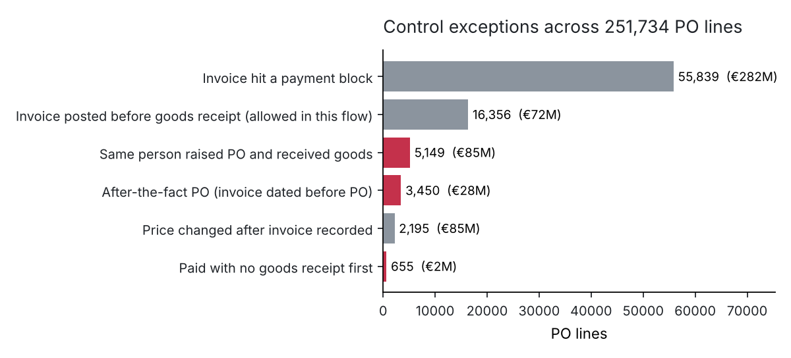
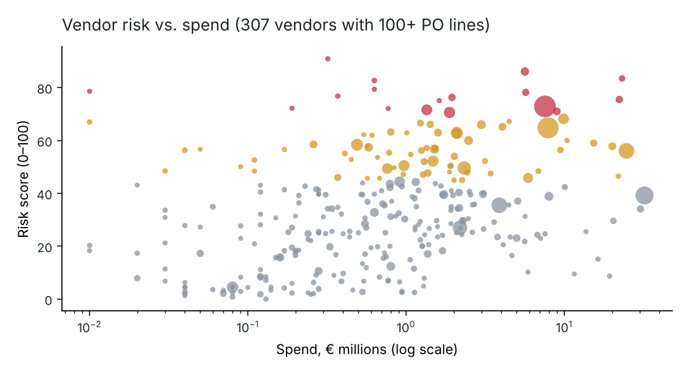

# SAP Procure-to-Pay: Control testing and vendor risk scoring

📊 **[Open the live dashboard](https://harleysdata.github.io/dashboards/p2p-controls.html)**: a guided story with filters, computed live from the data.

**Data:** a real SAP purchase-to-pay event log from a multinational coatings and paints company. 1.6 million events, 251,734 purchase-order lines, 76,349 purchase orders, 1,975 vendors, €997M of PO value, 2018.
**Tools:** Python (pandas, streaming XML parser) · SQL (SQLite, window functions) · process mining (variant analysis) · Power BI model · pytest.
**Question:** Which purchase-to-pay controls are failing, how much spend do the failures touch, and which vendors should procurement and third-party risk look at first?

---

## Summary

| | |
|---|---|
| PO lines with a high-risk exception (after-the-fact PO, paid without goods receipt, or same person ordered and received) | **8,887 lines, €108.5M** |
| Invoices that hit a payment block | **22%** of lines (55,839) |
| Lines set up as "invoice before goods receipt" | **88%** |
| Vendors scored (100+ PO lines) | **307**; 17 High-risk, holding €82.9M of spend |
| Median days from vendor invoice to payment | **63** (21% take more than 90) |
| Distinct process paths | **7,440**; the top 10 cover 61% of lines |

**Findings and what I'd do about them:**

1. **5,149 PO lines (€85M) were ordered and received by the same person.** This is a segregation-of-duties gap: one person can create a PO and confirm the goods arrived, which is the setup for paying for goods that never came. It's most common in the *invoice after GR* flow, where 15% of lines have it (vs. 1% elsewhere). → Restrict the GR transaction (MIGO) for users who hold PO-creation roles, or require a second approver above a value threshold.
2. **3,450 lines (€27.5M) are after-the-fact POs:** the vendor's invoice is dated before the PO existed, meaning the purchase was made first and the paperwork followed. It's concentrated: 50% of *Real Estate* lines, 14% of *Others* and 6% of *Trading & End Products* work this way, against under 1% in the big direct-materials areas. So do 57% of *2-way match* lines. → Publish a no-PO-no-pay policy for these spend areas and report after-the-fact POs by requester every month.
3. **88% of lines are configured as "invoice before goods receipt", and that setting creates most of the payment blocks.** When an invoice is posted before the goods receipt, 97% of those lines are blocked for payment (median 7 days) until the GR arrives. Those blocks aren't fraud, they're AP rework that the configuration creates. → For stock materials with reliable deliveries, switch the PO default to GR-based invoice verification so invoices wait for the GR instead of being blocked.
4. **655 lines were paid before any goods receipt.** That's small (€1.8M) but it's money out the door without proof of delivery. → Send these to AP for review and recovery.

---

## 1. Sourcing the data

The BPI Challenge 2019 log (4TU.ResearchData, CC BY 4.0) is an extract from the company's SAP system. Each case is one **PO line item**. Events cover requisition, PO creation and changes, order confirmation, goods receipt (GR), the vendor's invoice date, invoice receipt (IR), payment blocks and payment (Clear Invoice). Each line also carries its matching setup:

| Flow | What SAP checks before paying | Lines |
|---|---|---|
| 3-way match, invoice **after** GR | PO, GR and invoice must agree; invoice can't be posted until goods arrive | 15,182 |
| 3-way match, invoice **before** GR | Same three documents, but the invoice can be posted first and is blocked until GR | 221,010 |
| 2-way match | PO and invoice only; no goods receipt | 1,044 |
| Consignment | Stock owned by the vendor until used; settled separately, no line invoices | 14,498 |

The file is XES (the standard process-mining format), 729 MB of XML. pm4py isn't available in my environment, so I wrote a streaming parser ([`src/parse_xes.py`](src/parse_xes.py)) that reads it element by element into two flat tables (lines and events) in about 2 minutes, without loading the whole file into memory.

## 2. Cleaning

| Issue | Rows | Decision |
|---|---|---|
| Timestamps outside 2018–Jan 2019 (earliest 1948, latest 2020) | 327 events | Excluded from timing metrics, kept for counts. A 1948 posting date is a data-entry error |
| Same step, same minute, same user | 180,755 events | **Kept.** Timestamps are to the minute, so these are usually split deliveries or invoices posted together. Dropping them would undercount goods receipts |
| Spend area missing | 1.3% of lines | Kept as "unclassified" |
| PO value | from the PO-creation event | The log stores a running value; the value at PO creation is the committed amount |

Details are in [`reports/data_quality_log.csv`](reports/data_quality_log.csv).

## 3. How each control is tested

Each test looks at the first time each step happened on the line ([`src/transform.py`](src/transform.py)):

| Control | Test | Why it matters |
|---|---|---|
| After-the-fact PO | vendor invoice date < PO creation | Spend happened outside procurement; prices and terms weren't negotiated |
| Paid without goods receipt | 3-way line paid with no GR, or paid before the first GR | Money paid with no proof of delivery |
| Segregation of duties | same named user created the PO and posted a GR (system/batch users excluded) | One person controls ordering and receiving |
| Price change after invoice | PO price changed after the invoice was posted | Can be used to make a mismatched invoice pass the match |
| Payment block | invoice block later removed | AP rework; delays payment |

The process view ([`reports/top_variants.csv`](reports/top_variants.csv)) shows the happy path, *Create PO → Vendor invoice → GR → Invoice receipt → Pay*, covers only 20% of lines. There are 7,440 distinct paths.

## 4. Analysis



Red bars are the high-risk controls. *Value* is the PO value of the affected lines, not the amount at risk; a price change on a €1M line doesn't mean €1M was lost.

**Why invoice-before-GR matters.** In the 3-way flows, lines where the invoice came first were blocked 97% of the time, for a median of 7 days. All other 3-way lines were blocked 18% of the time. The block is the system doing its job, but someone in AP clears each one. If clearing a block takes 10 minutes (an assumption, not measured), the 55,839 blocks in this log come to about 9,300 hours, or roughly 5 full-time AP staff for a year.

### Vendor risk scorecard



Each of the 307 vendors with at least 100 PO lines gets a percentile for each control rate against its peers. Those percentiles are weighted (3× for the controls that can lose money directly: after-the-fact and paid-without-GR; 2× for SoD and price changes; 1× for payment blocks and rework), giving a 0–100 score ([`sql/marts.sql`](sql/marts.sql), `mart_vendor_risk`).

| Tier | Vendors | PO lines | Spend |
|---|---|---|---|
| High (≥70) | 17 | 29,399 | €82.9M (12%) |
| Medium (45–70) | 64 | 84,666 | €201.2M (30%) |
| Low | 226 | 112,868 | €382.4M (57%) |

Using percentiles instead of raw rates stops one control with large numbers (payment blocks) from swamping the rare but serious ones. I weighted by what could lose money, which is a judgment call; the weights are in one place in the SQL so a risk team can change them. The full list is in [`reports/vendor_risk_scorecard.csv`](reports/vendor_risk_scorecard.csv).

**How a third-party risk team would use it:** High-tier vendors go into the next quarterly review; anything with a paid-without-GR rate above 1% gets a statement reconciliation; Medium-tier vendors get the SoD and after-the-fact items sent to their requesters' managers.

## 5. Limitations

- Users are anonymised, so I can't check whether an SoD conflict was approved as an exception.
- Invoice and GR amounts aren't in the log, only the PO's running value. So I can test whether steps happened in order, not whether amounts matched.
- There are no payment terms, so 63 days to pay can't be judged as late or on time.
- This is one company's 2018 log; the weights in the risk score are my choice, not an industry standard.

## Reproduce

```bash
pip install -r ../requirements.txt
python src/run_pipeline.py     # parses the XES on first run (~2 min), then ~25 s
pytest -q tests                # 8 checks on control logic and table integrity
```

**Data credit:** van Dongen, B.F. (2019). *BPI Challenge 2019* [Dataset]. 4TU.ResearchData, CC BY 4.0. https://doi.org/10.4121/uuid:d06aff4b-79f0-45e6-8ec8-e19730c248f1
