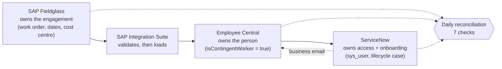

# Contingent Workforce Integration: Fieldglass → Employee Central → ServiceNow

**Type:** integration design and a working reconciliation tool.
**Systems:** SAP Fieldglass · SAP SuccessFactors Employee Central · ServiceNow (HR Service Delivery, ITSM) · SAP Integration Suite.
**Tools:** Python (pandas) · pytest · Mermaid for sequence diagrams.
**Question:** When a contractor's details live in three systems, how do you keep them in step, and how do you prove it's working?

---

## Why this project

I used Fieldglass, SuccessFactors/Employee Central and ServiceNow at Scotiabank. Each does its own job well. The problems sit in the gaps between them: a contract extended in Fieldglass but not in HR, a contractor who has left but can still log in, a start date with no laptop ready. These problems don't show up in any one system's reports, because each system looks correct on its own.

This project designs how the three should connect, then builds the check that finds where they disagree.

## What's here

| File | What it is |
|---|---|
| [`design/integration_design.md`](design/integration_design.md) | System ownership, hire-to-start and extension/end sequence diagrams, design choices, onboarding SLAs, controls matrix |
| [`design/field_mapping.csv`](design/field_mapping.csv) | 14 fields mapped across the three systems, with the rule and the system that owns each one |
| [`src/reconcile.py`](src/reconcile.py) | Three-way reconciliation: 7 checks, each with a severity and an owner |
| [`src/generate_sample.py`](src/generate_sample.py) | Builds sample extracts from the three systems with known defects planted |
| [`tests/test_reconcile.py`](tests/test_reconcile.py) | Proves the reconciliation finds every planted defect and raises no false alarms |

## The design in one picture



The main choice was to route contractors **through Employee Central** instead of connecting Fieldglass straight to ServiceNow. ServiceNow already receives employees from EC, so contractors get the same onboarding process, the same mappings and the same access reviews. The design doc explains the trade-off.

## The reconciliation

Fieldglass is the source of truth for whether an engagement is live. The tool joins the three extracts on the Fieldglass Worker ID and runs seven checks:

| Severity | Check | Owner |
|---|---|---|
| Critical | Work order ended, ServiceNow account still active | IAM / Service desk |
| Critical | Active contractor account with no Fieldglass work order | IAM |
| High | Work order ended, EC record still active | HR Operations |
| High | Active work order, no EC record | HR Operations |
| Medium | End date in EC differs from Fieldglass (extension not synced) | HR Operations |
| Medium | Cost centre in EC differs from Fieldglass | Finance / HR Ops |
| Low | Onboarding case closed after the worker's start date | HR Service Delivery |

Severity follows the consequence. Access that outlives a contract is a security finding that internal audit would raise. A cost-centre mismatch is a reporting problem. Each exception row names the team that owns the fix, so the output can go straight to a worklist.

### Results on the sample data

```
Critical  ended_account_active    54 workers  (1.8% of work orders)
Critical  orphan_account          33
High      ended_still_active_ec   40
High      missing_in_ec           15
Medium    end_date_mismatch      129
Medium    cost_center_mismatch    86
Low       late_onboarding        234   →  onboarding ready by start date: 92.1%
```

**About the data:** no public dataset of HR records exists, and there shouldn't be one. So `generate_sample.py` builds extracts for 3,000 contractors using each system's standard field names, and plants 591 defects at rates I set to be plausible (they aren't measured from any employer). The answer key lets the tests check the result exactly: **591 of 591 found, 0 false alarms.** I used the same planted-defect approach in my [AI answer evaluation](../05-ai-answer-accuracy-eval/).

## Running it on real extracts

Replace the four CSVs in `data/sample/` with real extracts that use the same column names:
- Fieldglass: a work order report.
- Employee Central: an Ad Hoc / Story report on EmpEmployment and EmpJob, filtered to `isContingentWorker = true`.
- ServiceNow: `sys_user` and the onboarding case table, exported from a list view.

Then run `python src/reconcile.py 2026-10-31`. In production this would run as a scheduled job, and its output would open ServiceNow tasks for each owner instead of writing a CSV.

## How this connects to the other projects

- [Project 1](../01-servicenow-service-desk-analytics/) found that 30% of a service desk's open time is spent waiting on the person who raised the ticket. Incomplete intake is the same root cause as a late onboarding case.
- [Project 4](../04-contractor-onboarding-product-case/) takes the late-onboarding and missing-record problems and treats them as a product: who it hurts, how to measure it, what to build first.

## Reproduce

```bash
python src/generate_sample.py
python src/reconcile.py
pytest -q tests
```
