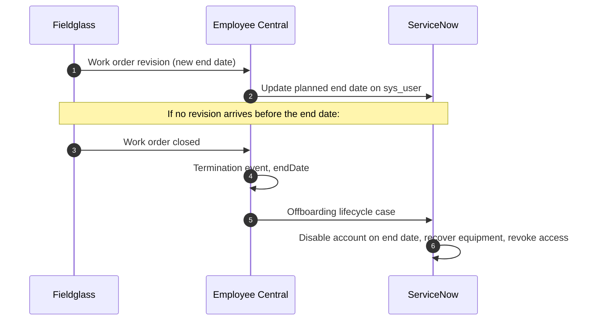

# Integration design: contingent worker lifecycle

## Systems and their jobs

| System | Owns | Contingent-worker objects used |
|---|---|---|
| **SAP Fieldglass** | The engagement: who the supplier is, the work order, dates, rate, cost centre | Job Posting, Work Order (and revisions), Worker |
| **SAP SuccessFactors Employee Central** | The person record that every downstream system reads | PerPerson, PerPersonal, PerEmail, EmpEmployment (`isContingentWorker`), EmpJob |
| **ServiceNow** (HR Service Delivery + ITSM) | Onboarding tasks, equipment, access, and offboarding | `sys_user`, HR lifecycle event case (`sn_hr_le_case`) and its tasks, catalog requests (`sc_req_item`) for equipment and access |

The principle: **each fact has one owner.** Fieldglass owns the engagement, EC owns the person, and ServiceNow owns access. Data flows one way, from owner to consumer, except the business email, which IAM creates and writes back.

## Hire to start

```mermaid
sequenceDiagram
    autonumber
    participant HM as Hiring manager
    participant FG as Fieldglass
    participant IS as SAP Integration Suite
    participant EC as Employee Central
    participant SN as ServiceNow
    HM->>FG: Approve job posting, select candidate
    FG->>FG: Work order approved by manager and supplier
    FG->>IS: Work order + worker (daily file or event)
    IS->>IS: Validate cost centre, manager, site against EC lists
    alt Validation fails
        IS-->>FG: Reject with reason; HR Ops worklist
    else Valid
        IS->>EC: Upsert PerPerson, EmpEmployment (isContingentWorker=true), EmpJob
        EC->>SN: New contingent hire (HR integration)
        SN->>SN: Create sys_user (inactive) and onboarding lifecycle case
        SN->>SN: Tasks: laptop, network ID, app access, building badge
        SN->>EC: Write back business email
        SN->>SN: Activate account on start date
    end
```

## Extension and end



## Why these choices

- **Fieldglass → EC → ServiceNow in a chain, not Fieldglass → ServiceNow directly.** ServiceNow already takes employees from EC. Feeding contractors through the same route gives one onboarding process, one set of mappings and one place for access reviews to look. The cost is a dependency: if the EC load fails, ServiceNow never hears about the worker. So the first check in the reconciliation is *active in Fieldglass, missing in EC*.
- **Validate before writing to EC.** Many contingent-worker data problems start as a bad cost centre or a hiring manager who has since left. Catching them in Integration Suite sends the problem back to the person who can fix it, instead of creating a bad EC record that someone has to correct later.
- **Account created inactive, activated on the start date.** Equipment and access can be prepared ahead of time without a live login existing before the worker starts.
- **The end date drives offboarding automatically.** Waiting for a manager to raise an offboarding ticket is how accounts stay active after contracts end. That's the Critical check in the reconciliation.

## Onboarding service levels

| Step | Target | Measured from |
|---|---|---|
| Work order approved → EC record created | 1 business day | Integration log |
| EC record → ServiceNow onboarding case opened | same day | `sn_hr_le_case.opened_at` |
| All onboarding tasks closed | before the worker's start date | `closed_at` vs. start date |
| Work order end → account disabled | same day | `sys_user.active` audit |

## Controls matrix

| Risk | Control | Type | Frequency | Evidence |
|---|---|---|---|---|
| Access continues after engagement ends | Automatic disable on EC termination; reconciliation check `ended_account_active` | Preventive + detective | Daily | `reports/exceptions.csv` |
| Accounts with no engagement behind them | Reconciliation check `orphan_account` | Detective | Weekly | Exceptions report, IAM sign-off |
| Worker starts with no HR record | Integration validation; check `missing_in_ec` | Preventive + detective | Daily | Integration log |
| Extensions not reflected in HR | Revision event to EC; check `end_date_mismatch` | Preventive + detective | Daily | Exceptions report |
| Costs charged to the wrong team | Cost-centre validation; check `cost_center_mismatch` | Preventive + detective | Monthly | Exceptions report |
| Worker unproductive on day one | Onboarding SLA on lifecycle tasks; check `late_onboarding` | Detective | Weekly | ServiceNow SLA report |
| Tenure beyond policy limit (co-employment risk) | Fieldglass tenure alert at 18 months; HR review | Preventive | Monthly | Fieldglass report |
