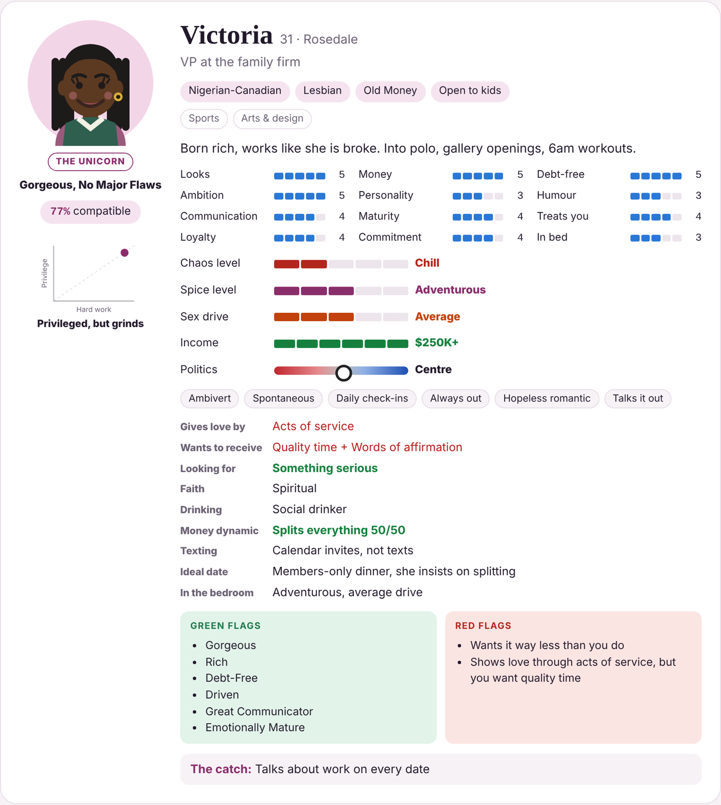
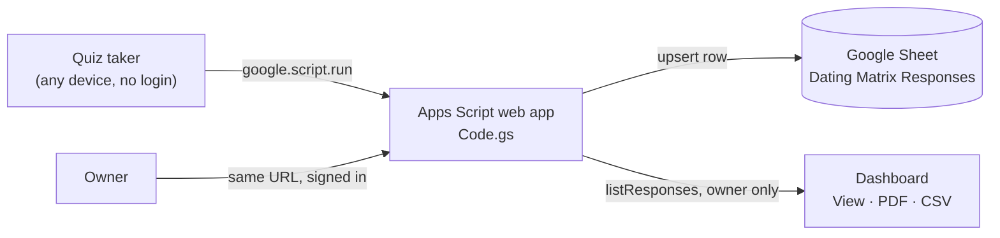
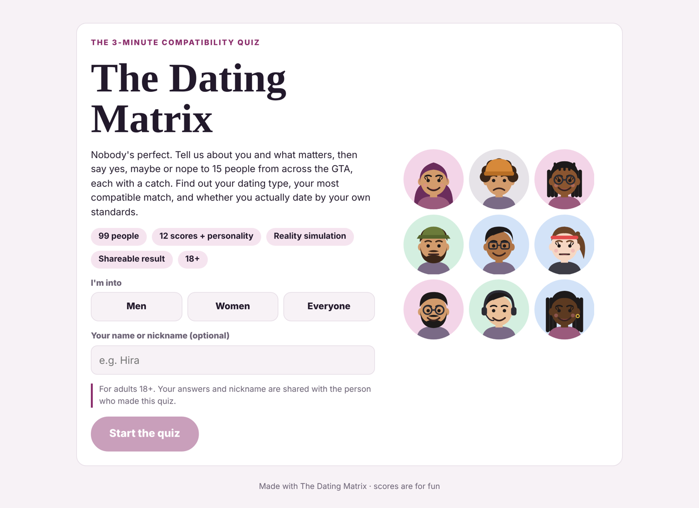
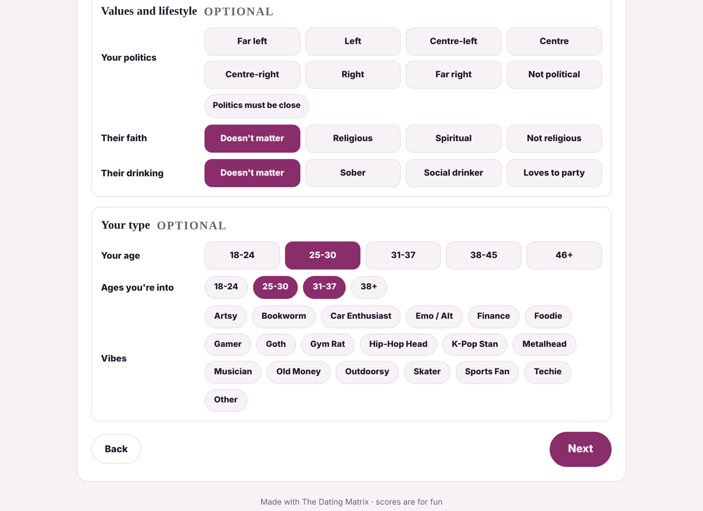
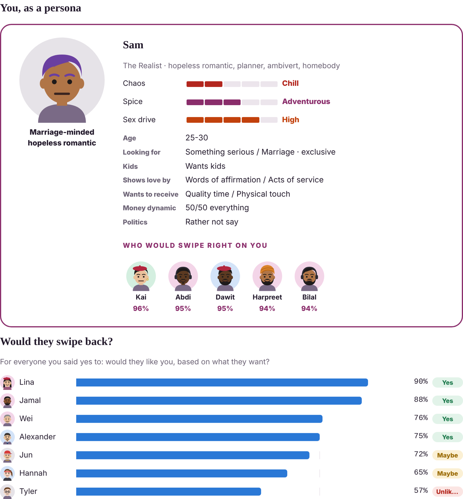
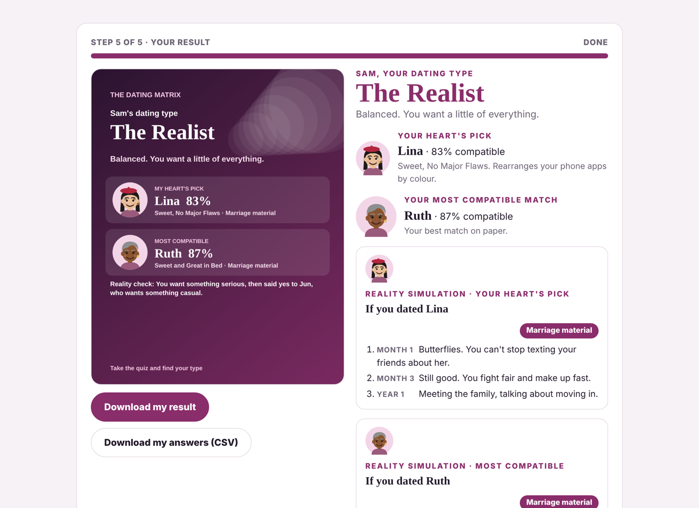

# The Dating Matrix

**A dating-standards reality check.** People set their standards, swipe on 119 GTA personas, and see who they would realistically end up with, where their standards contradict their swipes, and who would actually swipe back.

🔗 **Live app:** LIVE_URL
📁 **Code:** [`apps-script/`](apps-script/) · **Persona data:** [`data/personas.json`](data/personas.json)

## The problem

Dating "standards" are usually a wish list that nobody tests against reality. People say they want someone drama-free, then swipe right on chaos. They want a provider, but so does everyone else they like. I wanted a tool that turns stated preferences into data and then shows people, kindly but honestly, where those preferences and their real choices disagree.

I shared it with my community and collected responses in a Google Sheet, so the same data also tells me what people in the group value most.

## What it does

1. **About you (8 required taps).** What you're looking for, kids, chaos, spice, sex drive, love languages (giving and receiving) and money dynamic. Optional: income, background (self-made vs. nepo baby), politics, faith, drinking, age and type. Range-type questions accept several answers, because people are a range, not a point.
2. **Personality (optional).** Six traits such as introvert/extrovert, planner/spontaneous and how you handle a fight.
3. **Priorities.** 12 attributes from looks to emotional maturity, each weighted *Don't care*, *Nice to have*, *Important* or *Dealbreaker*.
4. **Swipe.** 15 personas drawn from a pool of 119 (62 men, 57 women) built for diversity across the GTA: ethnicity, faith, disability, sexuality, age 22–54, income, politics and family situation. Identities are never tied to flaws or scores.
5. **Results.**
   - Compatibility for everyone you rated, your heart's pick against the algorithm's pick, and your dating type.
   - **Reality check:** contradictions between your standards and your swipes (for example, "You want $100K+ income, but 3 of your yeses earn less").
   - **Reality simulation:** Month 1 → Month 3 → Year 1 for your top match.
   - **You, as a persona:** your own generated card, plus who would swipe right on you.
   - **Would they swipe back?** For every yes, how likely that person is to like you back, based on what *they* want.
   - A downloadable result image.

## Owner dashboard

Only the owner sees it (checked server-side with `Session.getActiveUser()`):

- KPIs, who people were into, who got the most yeses, dating types, top interests, and the average weight of each priority
- A table of every response, with **View** and **PDF** buttons for each person's full report
- **Download all (CSV)** for analysis in Excel or Power BI
- A backup import for offline "answer codes"

## How it works

| Layer | Detail |
|---|---|
| Front end | One HTML file: vanilla JavaScript, CSS and SVG. Cartoon avatars are generated procedurally; the result card is drawn on a canvas; PDF reports use jsPDF. |
| Back end | Google Apps Script (`Code.gs`): `saveResponse` upserts by response id under a script lock; `listResponses` is owner-only; formula injection is neutralised before writing cells. |
| Storage | A Google Sheet, created automatically on first run. One row per response, with the full answers kept as JSON. |
| Scoring | Compatibility = 70% weighted standards + 30% fit (what you are looking for, kids, age, chaos, spice, sex drive, love languages, money dynamic, politics, income, hustle, faith, drinking, exclusivity, personality, vibe and shared interests). Multi-select answers match on whichever pick fits each persona best. |

## Deploy your own copy (about 5 minutes)

1. Go to [script.google.com](https://script.google.com) → **New project**, and name it *Dating Matrix*.
2. Replace `Code.gs` with [`apps-script/Code.gs`](apps-script/Code.gs).
3. **File → New → HTML**, name it `Index`, and paste in [`apps-script/Index.html`](apps-script/Index.html).
4. Select `setup` in the function dropdown → **Run** → approve the permissions. This creates the *Dating Matrix Responses* Sheet in your Drive.
5. **Deploy → New deployment → Web app.** Set *Execute as:* **Me** and *Who has access:* **Anyone**. Copy the `/exec` URL.
6. Open that URL while signed in to the same Google account, and a **View responses** button appears for you only.

With [clasp](https://github.com/google/clasp) instead: `clasp create --type webapp --title "Dating Matrix" --rootDir apps-script`, then `clasp push` and `clasp deploy`.

## Screenshots

| Start | About you | Your persona | Results |
|---|---|---|---|
|  |  |  |  |

## Skills shown

Product thinking (turning a fuzzy social question into a measurable model), survey and scoring design, data collection pipeline (web app → Sheet → CSV), dashboarding, inclusive persona design, and a full-stack build on free Google tools.
