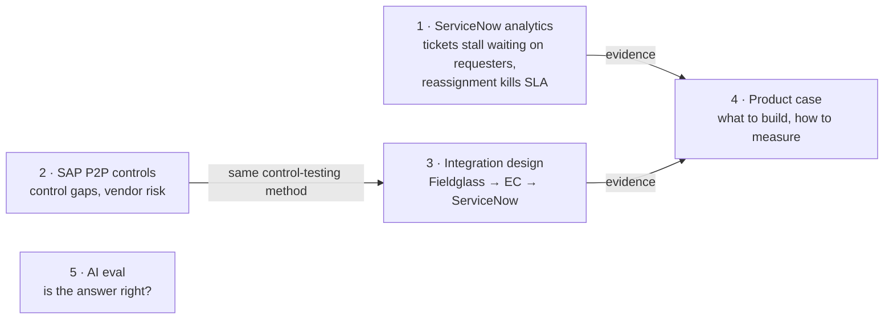

# Hira Hasan · Analytics, enterprise systems and product

I'm a former Senior Analyst at Scotiabank, where I worked in SAP Fieldglass, SAP SuccessFactors / Employee Central and ServiceNow. These projects show how I work: take messy operational data from those kinds of systems, find what's actually going wrong, and turn it into changes a team can ship and measure.

Projects 1 and 2 use **real, public enterprise data**: a ServiceNow incident audit log and an SAP purchase-to-pay event log of 1.6 million events. Project 3 designs the integration between the three systems I used. Project 4 turns the findings into a product plan. Project 5 applies the same "is this answer right?" thinking to AI. Project 6 is a community product I built and shared: a quiz web app that collects real responses.

🌐 **Portfolio site:** [harleysdata.github.io](https://harleysdata.github.io)

📊 **Live dashboards:** [ServiceNow service desk](https://harleysdata.github.io/dashboards/service-desk.html) · [SAP procure-to-pay controls](https://harleysdata.github.io/dashboards/p2p-controls.html). Each one has a guided story, filters and cross-filtering, and computes everything live from the real data. Power BI versions (data, DAX, theme and build guide) are in each project's `powerbi/` folder.

---

## Projects

| # | Project | Data | What it shows |
|---|---|---|---|
| 1 | [**ServiceNow Service Desk Analytics**](01-servicenow-service-desk-analytics/) | Real ServiceNow audit log: 141,712 events, 24,918 incidents | Event-log modelling, SQL marts, Power BI/DAX model, and assignment rules tested on a later time period. **Finding:** SLA falls from 78% to 14% as tickets get reassigned; 11 tested routing rules lift first-touch accuracy from 51% to 82% |
| 2 | [**SAP Procure-to-Pay Controls and Vendor Risk**](02-sap-procure-to-pay-compliance/) | Real SAP P2P event log: 1.6M events, 251,734 PO lines, €997M | Process mining, control testing, segregation of duties, vendor risk scoring with SQL window functions. **Finding:** 8,887 PO lines (€108.5M) with a high-risk exception; 17 vendors flagged for review |
| 3 | [**Contingent Workforce Integration**](03-contingent-workforce-integration/) | Sample extracts with planted defects | Fieldglass → Employee Central → ServiceNow field mapping, sequence diagrams, controls matrix, and a three-way reconciliation that finds 591 of 591 planted defects |
| 4 | [**Contractor Onboarding Hub: Product Case**](04-contractor-onboarding-product-case/) | Findings from Projects 1–3 | PRD, metrics tree, Jira-ready backlog, RICE with documented overrides, experiment sizing with clustering |
| 5 | [**AI Answer Accuracy Evaluation**](05-ai-answer-accuracy-eval/) | 15 Ontario employment-law questions | Rubric-based eval of AI answers, with planted errors to prove the grader catches them |
| 6 | [**The Dating Matrix**](06-dating-matrix/) | Quiz responses collected in a Google Sheet; 119 designed personas | Community quiz web app on Google Apps Script: weighted compatibility scoring, a "reality check" on stated vs. revealed preferences, and an owner dashboard with PDF reports and CSV export |

## How they connect



## Skills and where to find them

| Skill | Evidence |
|---|---|
| **SQL** | Star-schema warehouse and reporting views ([P1](01-servicenow-service-desk-analytics/sql/marts.sql)); `PERCENT_RANK` vendor scoring, CTEs, window shares ([P2](02-sap-procure-to-pay-compliance/sql/marts.sql)) |
| **Python (pandas)** | Event-log cleaning and fact tables ([P1](01-servicenow-service-desk-analytics/src/)); streaming XML parser for a 729 MB file ([P2](02-sap-procure-to-pay-compliance/src/parse_xes.py)); reconciliation engine ([P3](03-contingent-workforce-integration/src/reconcile.py)) |
| **Power BI / DAX** | Star-schema models, DAX with `USERELATIONSHIP` and `PERCENTILEX.INC`, a custom report theme, and load-ready data ([P1](01-servicenow-service-desk-analytics/powerbi/), [P2](02-sap-procure-to-pay-compliance/powerbi/), [theme](powerbi-theme/hira-dark.json)) |
| **Dashboard design and data storytelling** | Guided-story web dashboards with cross-filtering, written in plain JavaScript and SVG and hosted free on GitHub Pages ([service desk](https://harleysdata.github.io/dashboards/service-desk.html), [P2P](https://harleysdata.github.io/dashboards/p2p-controls.html)) |
| **Statistics and experimentation** | Holding priority constant to check a confounder; time-based train/test split ([P1](01-servicenow-service-desk-analytics/)); power analysis with design effect ([P4](04-contractor-onboarding-product-case/)) |
| **Process mining** | Variant analysis, throughput, conformance checks ([P2](02-sap-procure-to-pay-compliance/)) |
| **ServiceNow** | Audit log (`sys_audit`) analysis, assignment rules, SLA definitions, HR lifecycle events, `sys_user` ([P1](01-servicenow-service-desk-analytics/), [P3](03-contingent-workforce-integration/)) |
| **SAP Fieldglass / SuccessFactors EC** | Work orders and revisions; PerPerson, EmpEmployment, EmpJob mapping ([P3](03-contingent-workforce-integration/design/)) |
| **SAP S/4 purchasing** | 3-way vs. 2-way match, GR-based invoice verification, payment blocks ([P2](02-sap-procure-to-pay-compliance/)) |
| **Controls and compliance** | Segregation of duties, after-the-fact POs, access after termination, controls matrix ([P2](02-sap-procure-to-pay-compliance/), [P3](03-contingent-workforce-integration/design/integration_design.md)) |
| **Product management** | PRD, North Star and guardrails, RICE, roadmap, launch plan ([P4](04-contractor-onboarding-product-case/product/prd.md)) |
| **Jira / Agile** | Epics and user stories with acceptance criteria, CSV import format ([P4](04-contractor-onboarding-product-case/product/backlog.csv)) |
| **Testing and data quality** | pytest checks in every analytics project; planted-defect validation ([P3](03-contingent-workforce-integration/tests/), [P5](05-ai-answer-accuracy-eval/)) |
| **AI evaluation** | Rubrics, required facts vs. forbidden claims ([P5](05-ai-answer-accuracy-eval/)) |

## Run everything

```bash
pip install -r requirements.txt
python 01-servicenow-service-desk-analytics/src/run_pipeline.py
python 02-sap-procure-to-pay-compliance/src/run_pipeline.py
python 03-contingent-workforce-integration/src/generate_sample.py
python 03-contingent-workforce-integration/src/reconcile.py
python 04-contractor-onboarding-product-case/src/prioritise.py
python 05-ai-answer-accuracy-eval/evaluate.py
pytest -q
```

Everything runs on free tools: Python, SQLite and GitHub Pages.

## Data credits

- *Incident management process enriched event log*, Amaral, Fantinato & Peres. UCI Machine Learning Repository, CC BY 4.0.
- *BPI Challenge 2019*, van Dongen, B.F. 4TU.ResearchData, CC BY 4.0. doi:10.4121/uuid:d06aff4b-79f0-45e6-8ec8-e19730c248f1
